# ERD — Project 1: Quản lý bán hàng và kho

> Cập nhật cuối Tuần 3 (Ngày 21) — phản ánh đúng schema hiện có trong code, bao gồm cả phần Identity/permission (Tuần 2) và StockMovement (Tuần 3). Đây là bản ERD cuối cùng của Project 1.

```mermaid
erDiagram
    CATEGORY ||--o{ PRODUCT : "1-n, Restrict"
    SUPPLIER ||--o{ PRODUCT : "1-n, Restrict"
    PRODUCT ||--o{ ORDER_ITEM : "1-n, Restrict"
    PRODUCT ||--o{ STOCK_MOVEMENT : "1-n, Restrict"
    CUSTOMER ||--o{ ORDER : "1-n, Restrict"
    ORDER ||--o{ ORDER_ITEM : "1-n, Cascade"
    APPLICATION_USER ||--o{ ORDER : "1-n (CreatedBy), Restrict"
    APPLICATION_USER ||--o{ REFRESH_TOKEN : "1-n, Cascade"
    APPLICATION_USER }o--o{ APPLICATION_ROLE : "n-n qua AspNetUserRoles (Identity)"
    APPLICATION_ROLE ||--o{ ROLE_PERMISSION : "1-n, Cascade"
    PERMISSION ||--o{ ROLE_PERMISSION : "1-n, Cascade"

    CATEGORY {
        int Id PK
        string Name "required, unique, maxlength 100"
        string Description "nullable, maxlength 500"
    }

    SUPPLIER {
        int Id PK
        string Name "required, maxlength 200"
        string ContactName "nullable"
        string Email "nullable, maxlength 256"
        string Phone "nullable, maxlength 20"
        string Address "nullable, maxlength 500"
    }

    PRODUCT {
        int Id PK
        string SKU UK "required, unique, maxlength 50"
        string Name "required, maxlength 200"
        string Description "nullable, maxlength 1000"
        decimal Price "precision 18,2"
        int StockQuantity
        string Unit "required, maxlength 20"
        bool IsActive
        int CategoryId FK
        int SupplierId FK
        uint xmin "shadow property, concurrency token (Ngày 17)"
    }

    CUSTOMER {
        int Id PK
        string Name "required, maxlength 200"
        string Email "nullable, maxlength 256"
        string Phone "nullable, maxlength 20"
        string Address "nullable, maxlength 500"
    }

    ORDER {
        int Id PK
        string OrderCode UK "required, unique, maxlength 50"
        int CustomerId FK
        datetime OrderDate
        decimal TotalAmount "precision 18,2"
        int Status "enum: Pending/Processing/Completed/Cancelled"
        string Notes "nullable, maxlength 1000"
        int CreatedBy FK "-> AspNetUsers.Id, không có navigation (Domain không phụ thuộc Infrastructure)"
    }

    ORDER_ITEM {
        int Id PK
        int OrderId FK
        int ProductId FK
        int Quantity
        decimal UnitPrice "precision 18,2, chốt giá tại thời điểm đặt hàng"
    }

    STOCK_MOVEMENT {
        int Id PK
        int ProductId FK
        int Type "enum: Import/Export/Adjustment"
        int Quantity "dương = kho tăng, âm = kho giảm"
        int Reference "nullable, OrderId khi Export/hoàn kho, null khi nhập/điều chỉnh thủ công — không phải FK thật"
        datetime CreatedAtUtc
        string Note "nullable, maxlength 500"
    }

    APPLICATION_USER {
        int Id PK
        string Email UK "AspNetUsers (ASP.NET Identity)"
        string FullName "required"
        string PasswordHash
    }

    APPLICATION_ROLE {
        int Id PK
        string Name UK "AspNetRoles — Admin / Manager / Staff"
    }

    PERMISSION {
        int Id PK
        string Name UK "dạng resource.action, vd product.delete"
        string Description "nullable"
    }

    ROLE_PERMISSION {
        int RoleId PK_FK
        int PermissionId PK_FK
    }

    REFRESH_TOKEN {
        int Id PK
        string TokenHash UK "SHA-256, không lưu token thật"
        int UserId FK
        datetime CreatedAtUtc
        datetime ExpiresAtUtc
        datetime RevokedAtUtc "nullable"
        string ReplacedByTokenHash "nullable, dò chain reuse detection"
    }
```

## Ghi chú delete behavior (vì sao chọn Restrict/Cascade)

| Quan hệ | Behavior | Lý do |
|---|---|---|
| Category → Product | Restrict | Không xóa được danh mục còn sản phẩm — tránh mất liên kết dữ liệu |
| Supplier → Product | Restrict | Tương tự Category |
| Product → OrderItem | Restrict | Không xóa được sản phẩm đã từng xuất hiện trong đơn hàng — giữ lịch sử bán hàng |
| Product → StockMovement | Restrict | Giữ nguyên lịch sử biến động kho dù Product bị xóa (hiếm khi Product bị xóa cứng, thường chỉ `IsActive = false`) |
| Customer → Order | Restrict | Không xóa khách hàng còn lịch sử đơn hàng |
| ApplicationUser → Order (CreatedBy) | Restrict | Giữ truy vết ai tạo đơn, không xóa user kéo theo mất dữ liệu đơn |
| Order → OrderItem | Cascade | OrderItem không có ý nghĩa tồn tại độc lập — xóa Order thì xóa luôn item của nó |
| ApplicationUser → RefreshToken | Cascade | Xóa user thì refresh token của họ không còn ý nghĩa gì |
| ApplicationRole/Permission → RolePermission | Cascade | Bảng nối n-n, xóa 1 bên thì dòng nối không còn ý nghĩa |

Chi tiết quy tắc nghiệp vụ đầy đủ xem [2-tai-lieu-nghiep-vu.md](2-tai-lieu-nghiep-vu.md).
