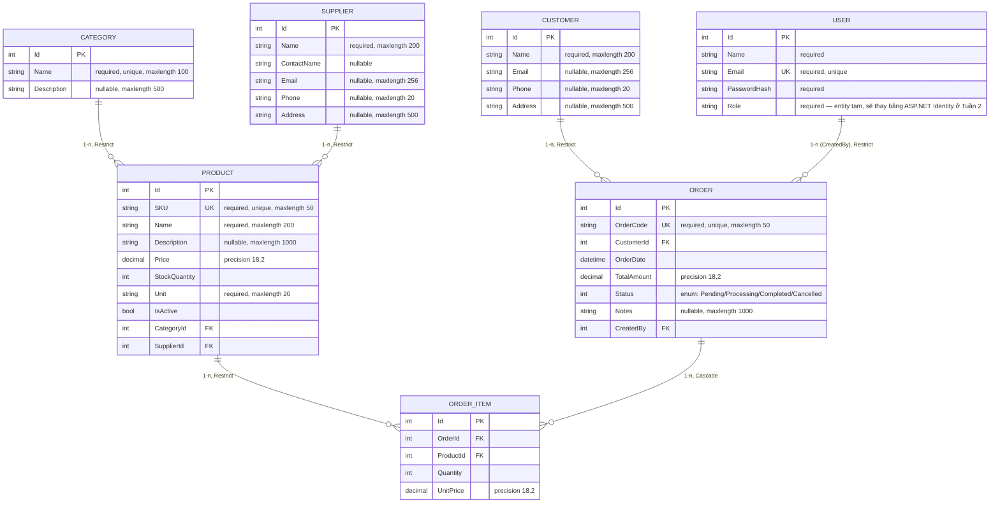

# ERD — Project 1: Quản lý bán hàng và kho

> Phản ánh đúng schema hiện có trong code (Ngày 1-5). Chưa có `StockMovement`, `Role`/`Permission`, `RefreshToken` — các bảng đó sẽ thêm ở Tuần 2-3, ERD sẽ cập nhật lại khi đó.

## Ghi chú delete behavior (vì sao chọn Restrict/Cascade)

| Quan hệ | Behavior | Lý do |
|---|---|---|
| Category → Product | Restrict | Không xóa được danh mục còn sản phẩm — tránh mất liên kết dữ liệu |
| Supplier → Product | Restrict | Tương tự Category |
| Product → OrderItem | Restrict | Không xóa được sản phẩm đã từng xuất hiện trong đơn hàng — giữ lịch sử bán hàng |
| Customer → Order | Restrict | Không xóa khách hàng còn lịch sử đơn hàng |
| User → Order (CreatedBy) | Restrict | Giữ truy vết ai tạo đơn, không xóa user kéo theo mất dữ liệu đơn |
| Order → OrderItem | Cascade | OrderItem không có ý nghĩa tồn tại độc lập — xóa Order thì xóa luôn item của nó |

Chi tiết quy tắc nghiệp vụ đầy đủ xem [2-tai-lieu-nghiep-vu.md](2-tai-lieu-nghiep-vu.md).
